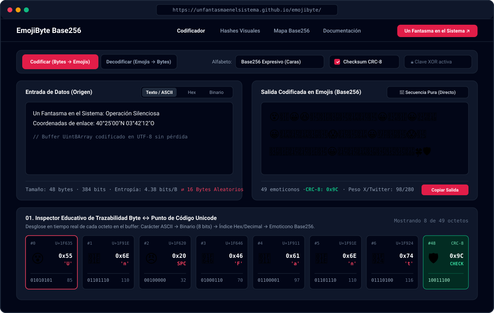
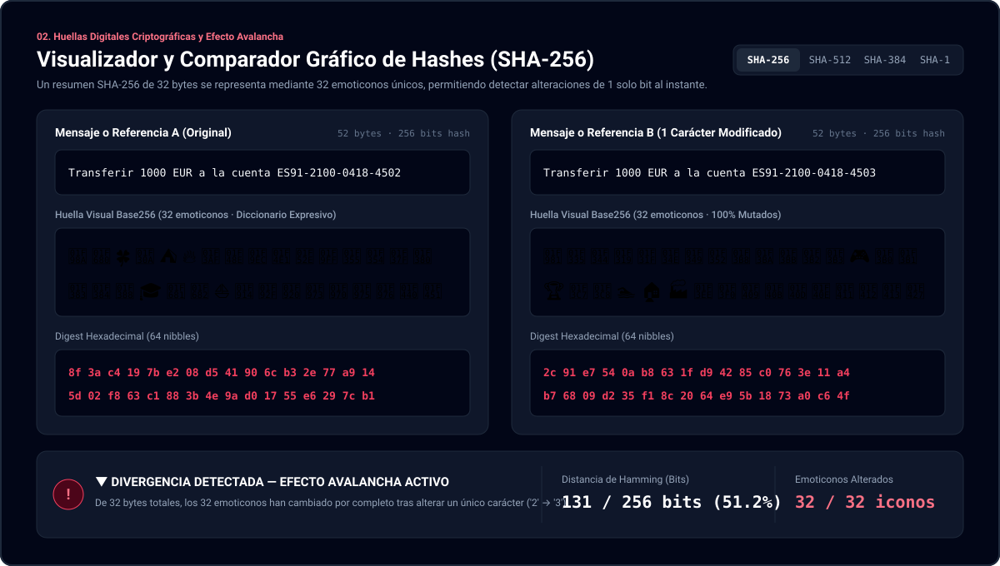
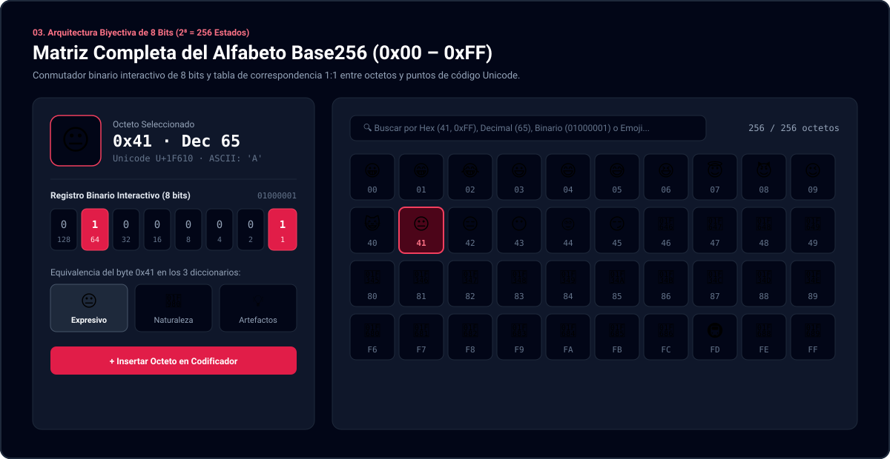

<div align="center">
  <a href="https://www.unfantasmaenelsistema.com/">
    
  </a>

  # EmojiByte Base256
  ### Codificador Biyectivo de Cadenas ASCII, UTF-8 y Objetos Byte en Emoticonos + Visualizador Criptográfico de Hashes

  <p>
    Una herramienta educativa y profesional de <strong>esteganografía lingüística</strong> y <strong>verificación visual de integridad</strong> desarrollada para <a href="https://www.unfantasmaenelsistema.com/"><strong>Un Fantasma en el Sistema</strong></a>.
  </p>

  <p>
    <a href="https://www.unfantasmaenelsistema.com/"></a>
    
    
    
    <a href="./LICENSE"></a>
  </p>
</div>

---

## 📋 Descripción General

**EmojiByte Base256** transforma cualquier flujo de datos (texto ASCII, cadenas internacionales UTF-8, volcados hexadecimales o archivos binarios arbitrarios `Uint8Array`) en una secuencia determinista de emoticonos Unicode y viceversa, utilizando una correspondencia matemática **biyectiva 1:1** donde cada octeto (`0x00` a `0xFF`, 256 valores posibles) se asigna a un único emoticono de punto de código simple.

Sus dos aplicaciones principales en ciberseguridad y divulgación técnica son:

1. **Esteganografía y Ocultación en Conversaciones (Chat / X / Twitter / Mensajería)**:
   Permite camuflar información sensible, coordenadas o claves dentro de mensajes cotidianos plagados de texto normal. Como el decodificador opera únicamente sobre los puntos de código del alfabeto Base256 seleccionado, **ignora y filtra automáticamente todo el texto de cobertura**, reconstruyendo los bytes originales sin pérdida.
2. **Huellas Digitales Visuales para Hashes Criptográficos (`SHA-256`, `SHA-512`, `SHA-384`, `SHA-1`)**:
   Comparar visualmente un hash SHA-256 de 64 caracteres hexadecimales (`8f3ac4197be2...`) es lento y vulnerable a ataques de suplantación parcial (prefijos/sufijos idénticos o ataques homoglifos). Al comprimir cada byte en un icono cromático distinto, un hash SHA-256 de 32 bytes se convierte en **32 emoticonos**, haciendo que cualquier alteración de 1 solo bit sea perceptible en fracciones de segundo gracias al *Efecto Avalancha*.

---

## 🖼️ Capturas de Pantalla de la Aplicación

### 1. Estación de Codificación Biyectiva Base256 e Inspector Byte a Byte
> Conversión en tiempo real de texto UTF-8, hexadecimal o archivos binarios a emoticonos con suma de verificación **CRC-8**, cifrado opcional por flujo **XOR** y trazabilidad completa de cada octeto (`Carácter ASCII → Binario 8 bits → Hex → Punto de Código Unicode`).



---

### 2. Visualizador y Comparador Gráfico de Hashes (Efecto Avalancha y Distancia de Hamming)
> Comparativa lado a lado de dos entradas mediante `crypto.subtle.digest`, mostrando la huella visual en emoticonos junto al resumen hexadecimal y calculando la **Distancia de Hamming en bits** para demostrar cómo cambiar un solo carácter muta ~50% de los bits del hash.



---

### 3. Matriz Completa del Alfabeto Base256 (`0x00`–`0xFF`) y Conmutador Binario de 8 Bits
> Explorador interactivo de los $2^8 = 256$ estados de un byte con interruptores binarios (`128, 64, 32, 16, 8, 4, 2, 1`), buscador en tiempo real y equivalencia simultánea entre los 3 diccionarios (*Expresivo*, *Naturaleza* y *Artefactos*).



---

## ⚙️ Arquitectura Técnica y Flujo de Datos

```text
┌───────────────────────────┐
│ Entrada (Texto / Hex / B) │
└─────────────┬─────────────┘
              ▼
┌───────────────────────────┐
│ Buffer UTF-8 (Uint8Array) │  ──► Cálculo de Entropía de Shannon (0.0 – 8.0 bits/B)
└─────────────┬─────────────┘
              ▼
┌───────────────────────────┐
│ [Opcional] Cifrado XOR    │  ──► Flujo derivado de clave (FNV-1a + xorshift32)
└─────────────┬─────────────┘
              ▼
┌───────────────────────────┐
│ [Opcional] Checksum CRC-8 │  ──► Polinomio generador 0x07 (x⁸ + x² + x + 1)
└─────────────┬─────────────┘
              ▼
┌───────────────────────────┐
│ Mapeo Biyectivo Base256   │  ──► Índice 0..255 ──► Punto de Código Unicode (U+1F...)
└─────────────┬─────────────┘
              ▼
┌───────────────────────────┐
│ Camuflaje Conversacional  │  ──► Inserción en plantillas de Chat / X (Twitter)
└───────────────────────────┘
```

### Comparativa frente a otras codificaciones binarias-a-texto

| Esquema | Tamaño del Alfabeto | Bits por Símbolo | Símbolos para SHA-256 (32 B) | Bytes UTF-8 en Red (32 B) | Propósito Principal |
| :--- | :---: | :---: | :---: | :---: | :--- |
| **Binario (Base2)** | 2 (`0, 1`) | 1 bit | 256 símbolos | 256 bytes | Inspección a nivel de registros y máscaras lógicas. |
| **Hexadecimal (Base16)** | 16 (`0-9, a-f`) | 4 bits (1 nibble) | 64 símbolos | 64 bytes | Volcados de memoria y resúmenes tradicionales. |
| **Base64 (RFC 4648)** | 64 (+ padding `=`) | 6 bits | 44 símbolos | 44 bytes | Transporte de binarios en JSON, MIME y cabeceras HTTP. |
| **EmojiByte (Base256)** | **256 emojis** | **8 bits (1 byte)** | **32 emoticonos** | 128 bytes (4 B/emoji) | **Verificación visual rápida de hashes y esteganografía en texto.** |

---

## 🚀 Instalación y Ejecución Local

Requisitos previos: **Node.js 18+** y **npm**.

```bash
# 1. Clonar el repositorio
git clone https://github.com/TU_USUARIO/emojibyte-base256.git
cd emojibyte-base256

# 2. Instalar dependencias
npm install

# 3. Iniciar servidor de desarrollo (http://localhost:3000)
npm run dev

# 4. Compilar versión de producción estática en ./dist
npm run build
```

---

## 🌐 Despliegue Automático en GitHub Pages

El proyecto está configurado nativamente para **GitHub Pages** sin necesidad de modificar rutas ni configurar servidores:

1. `vite.config.ts` utiliza `base: './'` (rutas relativas), por lo que la aplicación funciona tanto en un dominio raíz (`https://tudominio.com/`) como en una subruta de repositorio (`https://usuario.github.io/nombre-repo/`).
2. Incluye `/public/.nojekyll` para evitar que GitHub Pages ignore archivos estáticos.
3. Incluye el flujo de trabajo automatizado en [`.github/workflows/deploy.yml`](./.github/workflows/deploy.yml).

### Pasos para activar GitHub Pages en tu repositorio:
1. Sube este código a la rama `main` de tu repositorio en GitHub:
   ```bash
   git init
   git add .
   git commit -m "feat: lanzamiento inicial de EmojiByte Base256"
   git branch -M main
   git remote add origin https://github.com/TU_USUARIO/TU_REPOSITORIO.git
   git push -u origin main
   ```
2. En tu repositorio de GitHub, ve a **Settings → Pages**.
3. En **Build and deployment → Source**, selecciona **GitHub Actions**.
4. El workflow `Desplegar EmojiByte en GitHub Pages` compilará y publicará automáticamente la aplicación en cada `push`.

---

## 📂 Estructura del Proyecto

```text
├── .github/workflows/
│   └── deploy.yml                  # CI/CD automático para GitHub Pages
├── public/
│   ├── .nojekyll                   # Desactiva Jekyll en GitHub Pages
│   ├── assets/aistudio/
│   │   └── icono_81a3db5b.png      # Logotipo oficial de Un Fantasma en el Sistema
│   └── docs/screenshots/           # Capturas en alta resolución para el README
│       ├── 01-codificador-base256.svg
│       ├── 02-comparador-hashes-sha256.svg
│       └── 03-matriz-base256-8bits.svg
├── src/
│   ├── components/
│   │   ├── AlphabetMatrixExplorer.tsx  # Matriz 0x00-0xFF y registro interactivo de 8 bits
│   │   ├── EducationalGuideSection.tsx # Documentación, comparativa y kit GitHub
│   │   └── HashComparatorLab.tsx       # Comparador visual SHA-256 y Efecto Avalancha
│   ├── lib/
│   │   └── emojiCodec.ts           # Motor biyectivo Base256, CRC-8, XOR y Web Crypto
│   ├── App.tsx                     # Interfaz principal de la aplicación
│   ├── index.css                   # Configuración Tailwind CSS v4 y tipografía
│   └── main.tsx                    # Punto de entrada React
├── index.html                      # Metadatos SEO, OpenGraph y fuentes
├── LICENSE                         # Licencia MIT
├── package.json                    # Scripts y dependencias
└── vite.config.ts                  # Configuración Vite con base: './'
```

---

## 👤 Autoría y Créditos

Desarrollado para **[Un Fantasma en el Sistema](https://www.unfantasmaenelsistema.com/)** — Divulgación, ciberseguridad, criptografía y herramientas técnicas.

- 🌐 Sitio web oficial: [https://www.unfantasmaenelsistema.com/](https://www.unfantasmaenelsistema.com/)
- 📄 Licencia: Distribuido bajo la licencia [MIT](./LICENSE).
