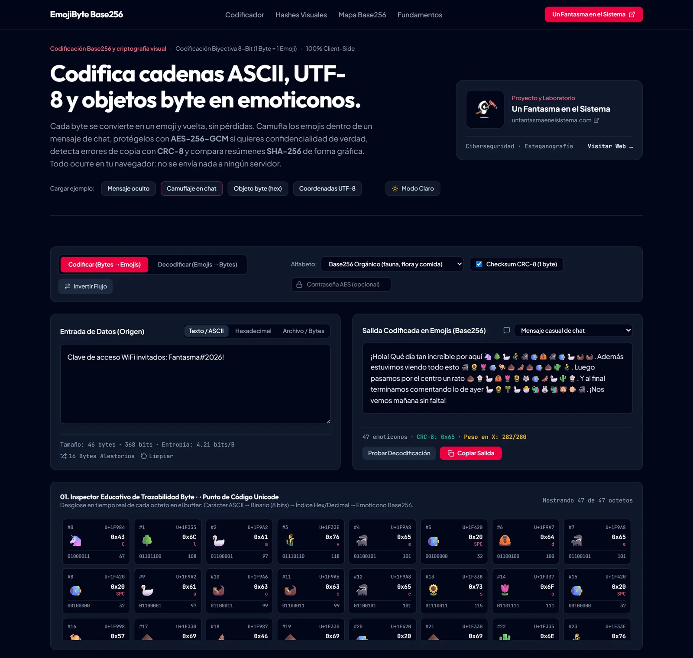
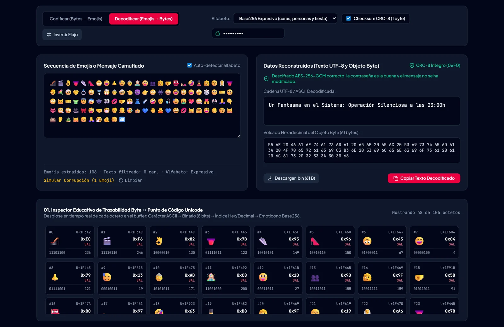
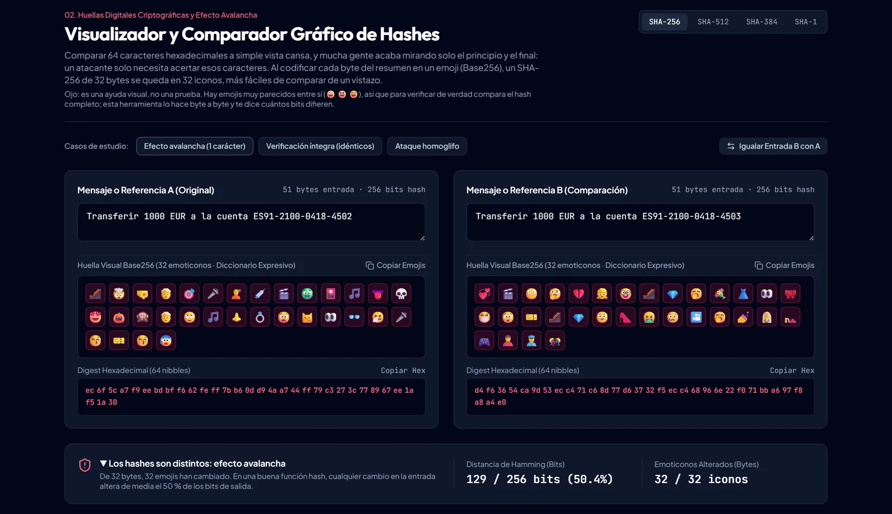
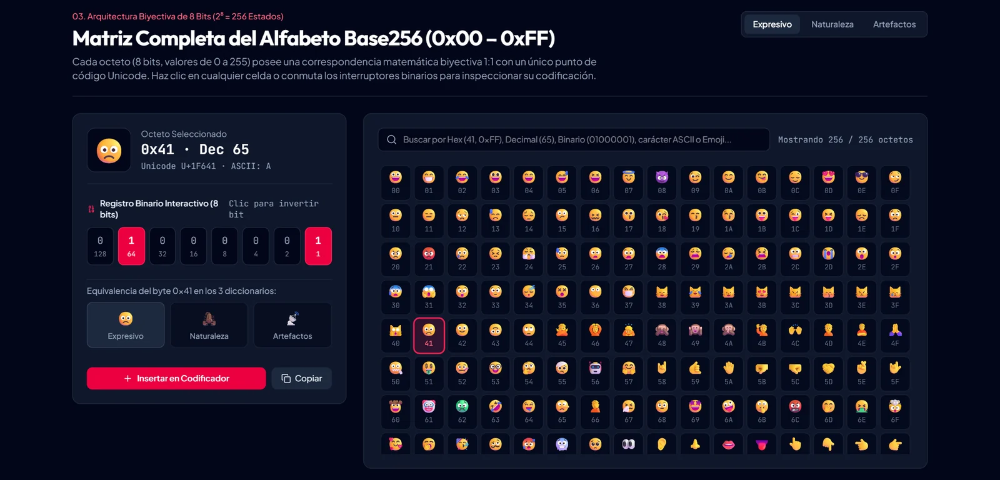

<p align="center">
  <a href="https://www.unfantasmaenelsistema.com"></a>
</p>

<h1 align="center">EmojiByte Base256</h1>

<p align="center">
  <b>Codifica texto, hexadecimal y archivos en emojis (1 byte = 1 emoji) y compara hashes de un vistazo</b><br>
  Tres alfabetos de 256 emojis · Camuflaje en mensajes de chat · CRC-8 · Cifrado AES-256-GCM opcional · Comparador visual de SHA-256
</p>

<p align="center">
  <a href="https://unfantasmaenelsistema.github.io/EmojiByte/"><b>▶ Abrir EmojiByte</b></a> ·
  <a href="#qué-hace">Qué hace</a> ·
  <a href="#cómo-funciona">Cómo funciona</a> ·
  <a href="#qué-protege-y-qué-no">Qué protege y qué no</a> ·
  <a href="#desarrollo">Desarrollo</a> ·
  <a href="https://www.unfantasmaenelsistema.com">unfantasmaenelsistema.com</a> ·
  <a href="LICENSE">MIT</a>
</p>

<p align="center">
  
  
  
  
</p>

<p align="center">
  
</p>

Un byte tiene 256 valores posibles; un alfabeto de 256 emojis permite escribir cada byte con un solo emoji y deshacerlo sin perder nada. EmojiByte usa esa idea para enseñar qué es una codificación binario-a-texto (como hexadecimal o Base64), cómo se comprueba la integridad de un mensaje, en qué se diferencia codificar de cifrar y por qué comparar hashes a ojo es más difícil de lo que parece.

> [!NOTE]
> Todo ocurre en tu navegador: no hay servidor ni peticiones de red (la página lo impide con su política de seguridad de contenidos). Lo que escribes, los archivos que cargas y las contraseñas no salen de tu equipo.

## Qué hace

- **Codificador y decodificador Base256** para texto UTF-8 (tildes, eñes, símbolos), bytes en hexadecimal (`48 6F 6C 61`, `0xde,0xad`…) o archivos (hasta 2.048 bytes; si el archivo es mayor, avisa de que solo se codifica el principio).
- **Tres alfabetos disjuntos** de 256 emojis: *Expresivo* (caras, personas, fiesta), *Naturaleza* (fauna, flora, comida) y *Artefactos* (informática, símbolos, transporte). Ningún emoji está en dos alfabetos, así que el decodificador detecta solo con cuál se escribió el mensaje.
- **Camuflaje**: secuencia pura, mensaje casual de chat, publicación en X/Bluesky o matriz de verificación por bloques. Al decodificar se descarta el texto que rodea a los emojis, y también los selectores `U+FE0F` que añaden algunas apps de mensajería.
- **Contador del peso en X** con las reglas reales de twitter-text (un emoji cuenta 2, las letras latinas 1) para saber si el mensaje cabe en 280.
- **CRC-8** opcional al final del mensaje y un botón para **simular la corrupción** de un emoji y ver cómo se detecta.
- **Cifrado AES-256-GCM** opcional con contraseña (clave derivada con PBKDF2-SHA256, 600.000 iteraciones, sal e IV aleatorios en cada mensaje).
- **Inspector byte a byte**: carácter → binario → hex → punto de código Unicode → emoji, con cada parte del paquete cifrado marcada como `SAL`, `IV`, `CIFR`, `TAG` y `CRC8`.
- **Comparador de hashes** SHA-256, SHA-384, SHA-512 y SHA-1 (con aviso de que SHA-1 está roto), huella en emojis, distancia de Hamming en bits y tres casos: efecto avalancha, archivos idénticos y ataque homoglifo (una «а» cirílica en una URL).
- **Matriz 0x00–0xFF** de cada alfabeto con buscador y un registro de 8 bits para encender y apagar bits.

<p align="center">
  
</p>

## Cómo funciona

```text
Texto / hex / archivo
        │  UTF-8 → bytes (Uint8Array)
        ▼
[opcional] AES-256-GCM  ──  sal(16) ‖ IV(12) ‖ cifrado ‖ etiqueta(16)   (+44 bytes)
        │
[opcional] CRC-8        ──  polinomio 0x07, 1 byte al final
        │
Alfabeto Base256        ──  byte 0..255 → 1 emoji (1 punto de código, U+1F3xx–U+1F9xx)
        │
Plantilla de camuflaje  ──  chat, X/Bluesky, matriz de bloques…
```

Para decodificar se recorre el texto, se quedan solo los emojis del alfabeto detectado, se comprueba el CRC-8 y, si hay contraseña, se descifra. AES-GCM no entrega nada si la contraseña es incorrecta o si ha cambiado un solo bit.

| Esquema | Alfabeto | Bits por símbolo | Símbolos para un SHA-256 (32 B) | Bytes UTF-8 |
| :--- | :---: | :---: | :---: | :---: |
| Binario | 2 | 1 | 256 | 256 |
| Hexadecimal | 16 | 4 | 64 | 64 |
| Base64 | 64 | 6 | 44 | 44 |
| **EmojiByte** | **256** | **8** | **32** | **128** (4 B por emoji) |

Los emojis ocupan menos símbolos pero más bytes: sirven para leer y comparar, no para ahorrar espacio.

<p align="center">
  
</p>

## Qué protege y qué no

- **Codificar no es cifrar.** Los alfabetos son públicos: sin contraseña, cualquiera con EmojiByte lee el mensaje.
- **El CRC-8 detecta errores accidentales**, no manipulaciones: quien altere el mensaje puede recalcularlo. La protección contra manipulaciones la da la etiqueta de AES-GCM.
- **No es esteganografía indetectable.** Una ristra de emojis llama la atención y, si va cifrada, su distribución es casi uniforme, muy distinta de cómo escribe una persona. El camuflaje sirve para entender qué es un canal encubierto.
- **Comparar emojis es una ayuda, no una prueba.** Hay emojis muy parecidos (😀 😃 😄); el comparador calcula la diferencia bit a bit, y eso es lo que vale.
- **Algunas apps cambian los emojis** al enviarlos (por imágenes o variantes). El decodificador tolera `U+FE0F`; cualquier otro cambio corrompe el mensaje y el CRC-8 lo avisa.

La pestaña *Seguridad y límites* de la app explica además por qué un «XOR con contraseña» casero no protege nada (reutilización de clave y espacio de 2³² estados).

<p align="center">
  
</p>

## Desarrollo

Requisitos: Node.js 20 o superior.

```bash
git clone https://github.com/unfantasmaenelsistema/EmojiByte.git
cd EmojiByte
npm ci
npm run dev      # http://localhost:3000
npm test         # 23 tests del motor (alfabetos, CRC-8, AES-GCM, camuflaje…)
npm run lint     # comprobación de tipos
npm run build    # versión estática en dist/
```

Cada `push` a `main` pasa por el workflow [`deploy.yml`](.github/workflows/deploy.yml) (tipos, tests y build) y se publica en GitHub Pages. Los pull requests ejecutan las mismas comprobaciones sin publicar.

```text
src/
├── lib/emojiCodec.ts            Alfabetos, CRC-8, AES-GCM, codificación, camuflaje y hashes
├── lib/emojiCodec.test.ts       Tests del motor (Vitest)
├── App.tsx                      Codificador, decodificador e inspector
└── components/
    ├── HashComparatorLab.tsx    Comparador de hashes y efecto avalancha
    ├── AlphabetMatrixExplorer.tsx  Matriz 0x00–0xFF y registro de 8 bits
    └── EducationalGuideSection.tsx Fundamentos, seguridad y comparativa
```

> [!IMPORTANT]
> Las tablas de `PALETTE_RANGES` son el «idioma» de los mensajes: si se cambian, los mensajes codificados antes dejan de poder leerse. Un test fija su huella SHA-256 para que no cambien sin querer.

## Novedades de la versión 2

- Alfabetos rehechos: sin emojis que se ven como texto o como un cuadro vacío (👁 🍽 🐿 🌶 📽 y U+1F4FE) y sin emojis compartidos entre alfabetos. **Los mensajes codificados con la versión 1 no son compatibles.**
- El «cifrado XOR» (xorshift de 32 bits sin sal ni IV) se sustituye por AES-256-GCM con PBKDF2.
- Avisos de archivo truncado y de hexadecimal con dígitos impares; insertar un byte no imprimible desde la matriz pasa a modo hexadecimal en lugar de escribir el texto `[0x01]`.
- Peso en X calculado con las reglas de twitter-text; se ignoran los `U+FE0F` al decodificar.
- Se arregla la instalación con npm (conflicto de dependencias) y se quitan dependencias que no se usaban (Gemini, Express, dotenv).
- Capturas reales, política de seguridad de contenidos, tema claro/oscuro recordado y diseño sin desbordes en móvil.

## Créditos y licencia

Desarrollado para **[Un Fantasma en el Sistema](https://www.unfantasmaenelsistema.com)**. Distribuido bajo licencia [MIT](LICENSE).
